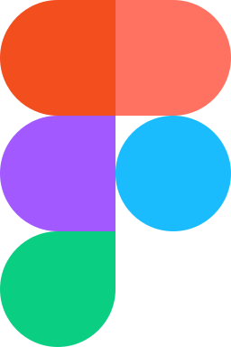

<a href="https://www.harrisonjennings.au/">
  <picture>
    <source media="(prefers-color-scheme: dark)" srcset="assets/mark-on-dark.svg">
    
  </picture>
</a>

## marketing, engineered.

> "If you want to be interesting, be interested." David Ogilvy

I'm Harrison, a tech-led marketing leader in Melbourne, working across MarTech, creative and media strategy. I currently lead global marketing automation, lifecycle and Marketo platform strategy in SaaS. I also build developer tools for the marketing stack: automation, APIs, data, integrations and analytics.

### what I've built

**[harrisonjennings.au](https://www.harrisonjennings.au/)**: my writing and projects on marketing automation, analytics and the web, updated regularly. I designed and built it from scratch in Astro on Cloudflare Workers, with its own [design system](https://design.harrisonjennings.au/) generated from the site's code. The [source](https://github.com/harrison-jennings/harrisonjennings.au) is public.

**[leadlens](https://leadlens.harrisonjennings.au)**: see how a Marketo email will look across 21 simulated email clients while you write it, right inside VS Code. Problems are flagged at the exact line with one-click fixes, and it runs locally with no telemetry and no account.

**[API reference for Marketo Engage](https://mkto-ref.harrisonjennings.au/)**: a searchable reference to five Marketo APIs, with a request builder that turns any operation into code samples and a mock response. It's generated from Adobe's published specifications and checked for changes every week. Independent project, not authorized, endorsed or sponsored by Adobe.

### latest writing

<!-- posts:start -->
- [leadlens is now on the VS Code Marketplace](https://www.harrisonjennings.au/blog/leadlens-is-now-on-the-vs-code-marketplace/)
- [a brand that documents itself](https://www.harrisonjennings.au/blog/a-brand-that-documents-itself/)
- [what my analytics warehouse sees that Google Analytics doesn't](https://www.harrisonjennings.au/blog/what-my-analytics-warehouse-sees-that-google-analytics-doesnt/)
<!-- posts:end -->

### what I work with

 &nbsp;  &nbsp;  &nbsp;  &nbsp; <picture><source media="(prefers-color-scheme: dark)" srcset="assets/icons/hightouch-on-dark.svg"></picture> &nbsp;  &nbsp;  &nbsp;  &nbsp;  &nbsp;  &nbsp;  &nbsp; <picture><source media="(prefers-color-scheme: dark)" srcset="assets/icons/retool-on-dark.svg"></picture> &nbsp; <picture><source media="(prefers-color-scheme: dark)" srcset="assets/icons/chatgpt-on-dark.svg"></picture> &nbsp;   &nbsp;  &nbsp;  &nbsp;  &nbsp;  &nbsp;  &nbsp;  &nbsp;  &nbsp;  &nbsp; <picture><source media="(prefers-color-scheme: dark)" srcset="assets/icons/github-on-dark.svg"></picture> &nbsp;  &nbsp; <picture><source media="(prefers-color-scheme: dark)" srcset="assets/icons/vercel-on-dark.svg"></picture> &nbsp;  &nbsp; 

[website](https://www.harrisonjennings.au/) · [all posts](https://www.harrisonjennings.au/blog/) · [LinkedIn](https://www.linkedin.com/in/harrison-jennings/)
